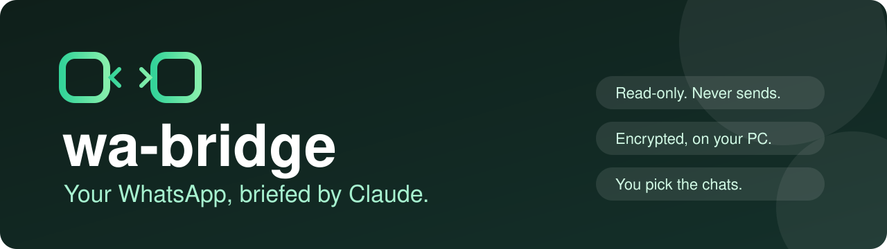
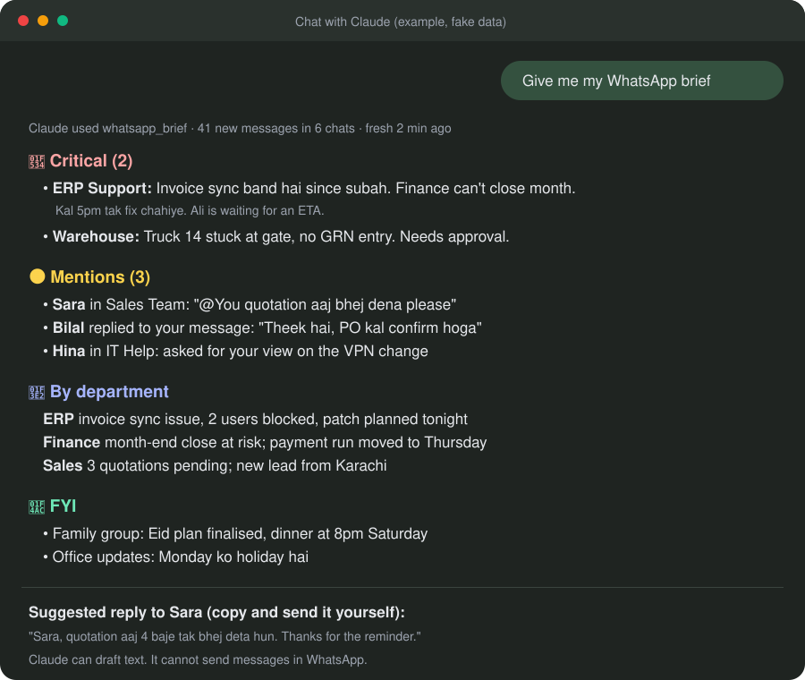
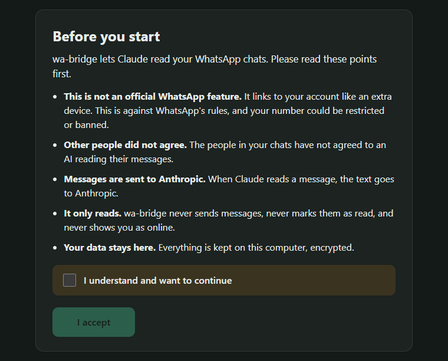
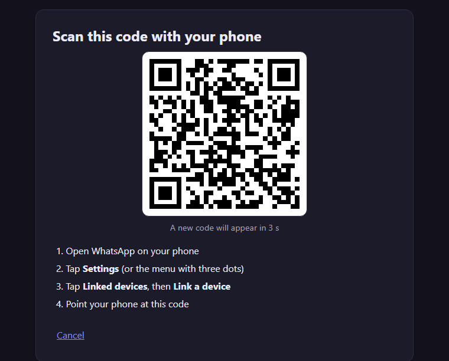
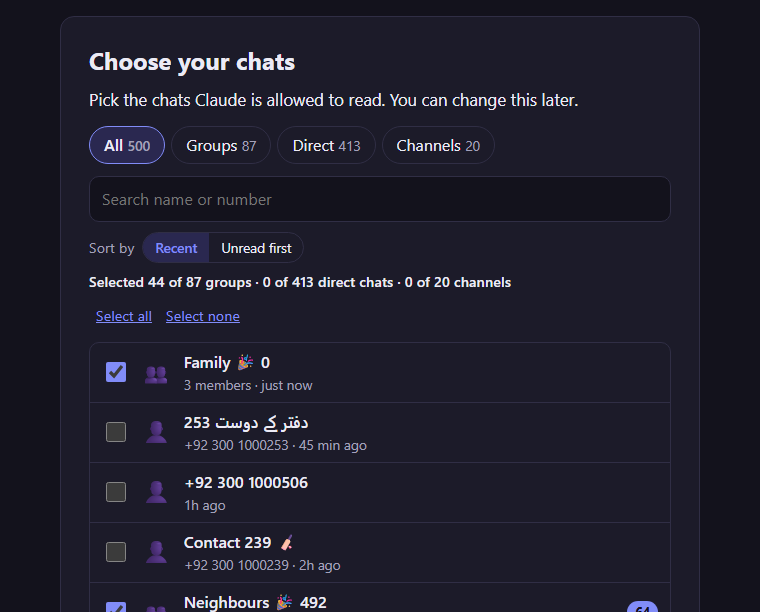
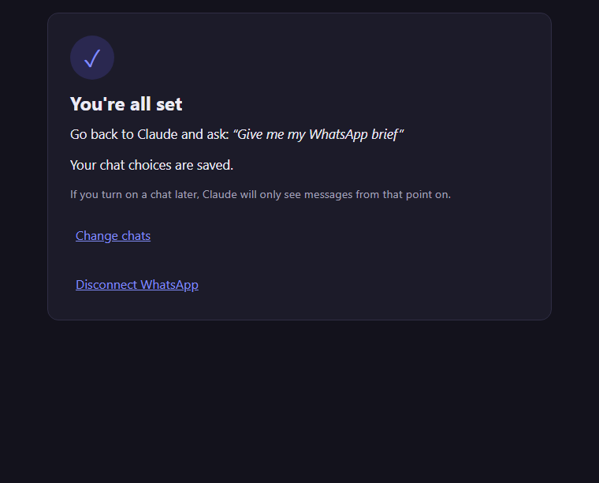
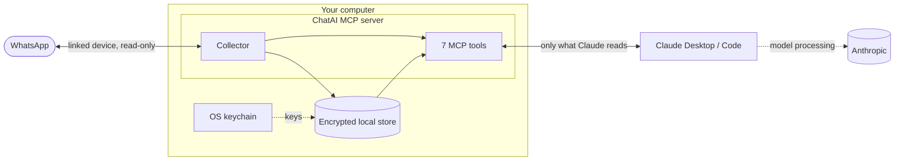

<div align="center">



# ChatAI for WhatsApp: summaries, mentions and bills in Claude Desktop (MCP server)

**A read-only, local MCP server that lets Claude brief you on the WhatsApp chats you choose.**<br>
Daily WhatsApp brief, mentions, follow-ups, bills and payment screenshots. Roman Urdu and English. Encrypted on your PC.

[](https://github.com/zuhaibasad/whatsapp-claude-mcp/actions/workflows/ci.yml)
[](https://github.com/zuhaibasad/whatsapp-claude-mcp/releases)
[](LICENSE)


</div>

> [!NOTE]
> Independent open-source project. Not affiliated with or endorsed by WhatsApp, Meta, or Anthropic.

## What it does

- 📋 **Daily brief.** Ask "Give me my WhatsApp brief". Get Critical, Mentions, By department and FYI.
- 🧾 **Bills and payment screenshots.** Images are read on your PC (local OCR). Claude gets the amount, date, reference and bank as text, not the picture, so it costs few tokens.
- 🔎 **Search and follow-ups.** Find old messages. Save action items. Export them to CSV or JSON.
- 🛡️ **Read-only and private.** Never sends. Never marks read. Data stays on your PC, encrypted.

<div align="center">

<br><sub>Example with fake data. Claude writes the summary. ChatAI only supplies the messages.</sub>
</div>

## Why ChatAI?

Most WhatsApp MCP servers give an AI full control of your account. ChatAI is built for the opposite job: let Claude **read and brief**, nothing more.

| | ChatAI for WhatsApp | Typical WhatsApp MCP server |
|---|---|---|
| Sending, reactions, read receipts | Never. Blocked by tests in the build | Usually available to the AI |
| Install | One `.mcpb` file, setup inside the chat | Clone, Go/Python toolchains, JSON config |
| Storage | Encrypted, key in the OS keychain | Often a plain SQLite file |
| Which chats | Only the ones you pick | Usually everything |
| Bills and screenshots | Read on your PC (local OCR), sent to Claude as text | Image sent to the AI, or not supported |

If you need Claude to send messages for you, ChatAI is not the right tool.

## How setup looks

Setup runs inside the Claude chat (or in your browser for Claude Code). Four steps, about two minutes.

<table>
<tr>
<td align="center" width="25%"><b>1. Accept</b></td>
<td align="center" width="25%"><b>2. Scan QR</b></td>
<td align="center" width="25%"><b>3. Choose chats</b></td>
<td align="center" width="25%"><b>4. Ask Claude</b></td>
</tr>
<tr>
<td><picture><source media="(prefers-color-scheme: light)" srcset="docs/assets/setup-needs_accept-light.png"></picture></td>
<td><picture><source media="(prefers-color-scheme: light)" srcset="docs/assets/setup-linking-light.png"></picture></td>
<td><picture><source media="(prefers-color-scheme: light)" srcset="docs/assets/setup-choose_chats-light.png"></picture></td>
<td><picture><source media="(prefers-color-scheme: light)" srcset="docs/assets/setup-done-light.png"></picture></td>
</tr>
<tr>
<td>Read the risks. Tick the box.</td>
<td>Phone: Linked devices, then Link a device.</td>
<td>Search by name or number. Groups, direct chats, channels.</td>
<td>Say: "Give me my WhatsApp brief".</td>
</tr>
</table>

<sub>Screenshots use mock data.</sub>

## Install in 2 minutes (Claude Desktop, Windows or macOS)

1. Get the file for your computer from the [Releases](../../releases) page: `chatai-<version>-windows.mcpb` (Windows x64) or `chatai-<version>-macos.mcpb` (Apple Silicon and Intel Macs). No release yet? Build it: `npm ci` then `npm run build:mcpb` (the file appears in `build/`).
2. Claude Desktop: **Settings, Extensions, Advanced settings, Install Extension**. Pick the file. Enable **ChatAI for WhatsApp**.
3. In a chat, say **"Set up WhatsApp"** and follow the four steps above.

Tools missing? Quit Claude Desktop fully and open it again. You need Windows 10/11 (x64) or macOS, your own phone with WhatsApp, and a Claude account.

<details>
<summary><b>Claude Code (from source)</b></summary>

```powershell
git clone https://github.com/zuhaibasad/whatsapp-claude-mcp.git
cd whatsapp-claude-mcp
npm ci
npm run build
claude mcp add --transport stdio --scope user chatai -- "$((Get-Command node).Source)" "$((Resolve-Path dist/mcp/main.js).Path)"
```

Needs Node.js 24 or newer (on Node 22 the encrypted database module must be compiled, which needs Visual Studio build tools). In Claude Code run `/mcp` to check, then say "Set up WhatsApp". Setup opens in your browser. Optional skills for briefs, mentions, reports and export are in [`skills/`](skills/README.md).
</details>

## Updating and uninstalling

- **Update:** install the new `.mcpb` the same way. Your link and data stay. The database is backed up before any upgrade.
- **Uninstall:** in Claude Desktop, **Settings, Extensions**, remove **ChatAI for WhatsApp**. On your phone, **WhatsApp, Linked devices**, remove the device (it shows as a Windows or Mac desktop). Delete the data folder (see [Settings](#settings)). The encryption key is in Windows Credential Manager (entries ending in `.chatai`) or macOS Keychain Access (entries named `chatai`); remove it there too.

## Things to ask Claude

| Ask | You get |
|---|---|
| "Give me my WhatsApp brief" | Critical, Mentions, By department, FYI |
| "Who mentioned me since my last review?" | Mentions and replies, with suggested text to copy |
| "Search ERP Support for invoice issues, last 7 days" | Matching messages with sender and time |
| "Save this as a high-priority Finance follow-up" | A local action item |
| "Total the payments posted in Accounts this week" | Amounts, dates and references read from the screenshots |
| "Show my open items by department" | Your follow-up list, oldest first |
| "Stop reading the Family group" | Chat selection updated |

## How it works



The collector lives inside the MCP server, so it runs only while Claude is open. There is no cloud relay and no public endpoint.

## Settings

Edit `config.yaml` in the data folder: `%USERPROFILE%\.chatai` on Windows, `~/Library/Application Support/chatai` on macOS. Changes apply within a minute; no restart needed. Usually you only touch chat selection, and Claude does that for you ("stop reading the Family group").

| Setting | Default | What it does |
|---|---|---|
| `retention_days` | `30` | Messages and images older than this are deleted |
| `timezone` | system zone | Times shown to Claude |
| `include_groups` / `include_direct_chats` / `include_channels` | `true` / `false` / `false` | Which chat types are read by default |
| `allowlist` / `denylist` | `[]` | Chat names or ids to always include / always skip (denylist wins) |
| `my_names` | `[]` | Your names and nicknames, so "Zuhaib bhai, please check" counts as a mention |
| `max_text_chars` | `2000` | Longer messages are cut |
| `media_download` | `true` | Download images in selected chats (stored encrypted) |
| `media_ocr` | `true` | Read text in those images on this PC |
| `media_max_mb` | `500` | Image storage cap. Oldest images go first; their text is kept |
| `log_level` | `info` | `error`, `warn`, `info` or `debug`. Logs never contain message text |

Per-chat notes ("the ERP group is for supplier invoices") live in `departments.yaml`. Just tell Claude and it adds them.

## Private by design

- 🏠 **Local only.** Messages are stored in `%USERPROFILE%\.chatai` (Windows) or `~/Library/Application Support/chatai` (macOS). The setup page listens on `127.0.0.1` only.
- 🔐 **Encrypted.** The message database and the WhatsApp session are encrypted. The key is in the OS keychain (Windows Credential Manager or macOS Keychain), never in a file.
- 👀 **Read-only.** No sending, no blue ticks, no "online" status. Code checks in the test suite block write APIs.
- ✅ **You choose the chats.** Excluded chats are not stored. Direct chats and channels start off. Messages expire after 30 days by default.
- 🧱 **Untrusted content.** Setup secrets (QR, tokens) never enter Claude's tool results. Every result that carries chat text or image text is marked as data from other people, and Claude is told never to follow instructions found in it.
- 🧨 **Prompt injection is still a risk.** Someone in a group could write a message, or post a screenshot, aimed at the AI. ChatAI cannot send anything, which limits the damage. Still, be careful when Claude suggests exporting data or opening links it found in chats.

> [!WARNING]
> **Know the risks before you connect.**
> - This is an **unofficial linked device**. It is against WhatsApp's Terms of Service. Your number could be restricted or banned.
> - **Other people in your chats did not agree** to an AI reading their messages. Think before you add work or family groups.
> - **Text that Claude reads is sent to Anthropic.** Local storage does not mean local AI.
> - Connect only your own account.

## Troubleshooting

| Problem | Fix |
|---|---|
| The WhatsApp tools are missing in Claude | Quit Claude Desktop fully (Windows: also from the tray; macOS: Cmd+Q) and open it again |
| "WhatsApp logged this device out" | Say "set up WhatsApp" and scan the QR code again |
| "The collector is not running" or old data | It runs only while Claude is open. Keep Claude open; it catches up on start |
| An image shows `expired` | WhatsApp no longer has the file (old image). ChatAI never asks your phone to re-send it |
| An image shows `pending` | It is still being downloaded and read. Ask again in a minute |
| Anything else | Ask Claude to **"run a WhatsApp diagnose"**. It checks the folder, key, connection and disk, and gives plain-language fixes |

## FAQ

<details><summary>Does it send messages?</summary>
<br>No. Claude can draft a reply, and you copy and send it yourself. The only write call to WhatsApp is the logout used to disconnect.
</details>

<details><summary>Where is my data stored?</summary>
<br>On your computer, in <code>%USERPROFILE%\.chatai</code> (Windows) or <code>~/Library/Application Support/chatai</code> (macOS): <code>store.db</code> and <code>auth.db</code> (encrypted), plus plain config files and exports. Exports and YAML files are not encrypted, so protect them.
</details>

<details><summary>What if Claude is closed?</summary>
<br>Nothing is collected while Claude is closed. When you open it again, ChatAI catches up on what WhatsApp still provides. Long gaps can leave holes.
</details>

<details><summary>Why not claude.ai in the browser?</summary>
<br>claude.ai connectors run from Anthropic's cloud and cannot reach a program on your PC. Supporting it would mean a tunnel or relay that exposes your chats to the internet. This project chooses not to.
</details>

<details><summary>How many tokens does it use?</summary>
<br>A brief is one tool call with capped text sizes. Messages Claude reads count toward your normal Claude usage. Choose fewer chats to use less.
</details>

<details><summary>How do I disconnect?</summary>
<br>On your phone: WhatsApp, Linked devices, remove the device ChatAI linked (it shows as a Windows or Mac desktop). Delete the data folder to remove local data. This does not recall text already sent to Claude.
</details>

## Roadmap

PDF bills, Urdu text in images, voice-note transcription (local), missed-call items, macOS and Linux. See [docs/ROADMAP.md](docs/ROADMAP.md). Not built yet. What changed so far: [CHANGELOG.md](CHANGELOG.md).

<details>
<summary><b>Contributing and development</b></summary>

```powershell
npm ci
npm run check      # lint, typecheck, tests
npm run build
npm run build:mcpb # Claude Desktop bundle
```

Read [docs/PLAN.md](docs/PLAN.md), [docs/DECISIONS.md](docs/DECISIONS.md) and [docs/notes/](docs/notes/). Keep the read-only rule. Use fake fixtures. Never commit a real `.chatai` folder, QR, session or export.

Seven MCP tools: `whatsapp_brief`, `whatsapp_status`, `whatsapp_read`, `whatsapp_items`, `whatsapp_mark_reviewed`, `whatsapp_setup`, `whatsapp_choose_chats`.
</details>

## License

[MIT](LICENSE) for this project's code. Dependencies keep their own licenses (see [NOTICE](NOTICE)): the bundled `libsignal` (via `baileys`) is GPL-3.0. Details in [docs/LICENSE_OPTIONS.md](docs/LICENSE_OPTIONS.md).

## Disclaimer

ChatAI for WhatsApp is an independent project. It is not affiliated with, authorized by, or endorsed by WhatsApp LLC, Meta Platforms, or Anthropic. WhatsApp, Meta and Claude are trademarks of their owners, used here only to describe compatibility. Use at your own risk and follow the laws and terms that apply to you.

<div align="center"><sub>Built by <a href="https://github.com/zuhaibasad">Zuhaib Asad</a></sub></div>
