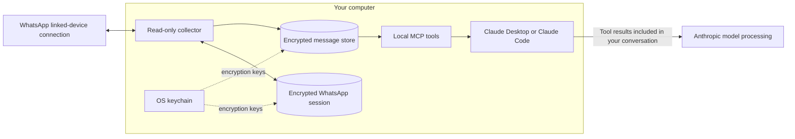

<div align="center">

# WhatsApp × Claude

### Your conversations, brought into focus. Your WhatsApp, kept under your control.

A local WhatsApp bridge for **Claude Desktop** and **Claude Code**.<br>
Catch up, find mentions, and track follow-ups from the chats you choose.

**Read-only WhatsApp access · Encrypted local storage · User-controlled chat selection · [Apache 2.0](LICENSE)**

[Privacy](#privacy-by-design) · [Features](#what-you-can-do) · [Quick start](#quick-start) · [Onboarding](#the-onboarding-experience) · [Limitations](#limitations) · [Premium](#premium-solutions) · [License](#license)

</div>

---

> **Know the boundary before connecting.** The bridge stores data on your computer, but **message text that Claude reads is sent to Anthropic for processing**. This is an unofficial WhatsApp linked-device client, with a risk of account restriction or suspension. Connect only your own account and consider the privacy of everyone in your chats.

## A quieter way to catch up

Ask **“Give me my WhatsApp brief”** and turn a busy inbox into a focused overview: urgent issues, messages addressed to you, updates by department, and follow-ups to track.

The bridge gives Claude context through the [Model Context Protocol (MCP)](https://modelcontextprotocol.io/). It does not give Claude a way to send WhatsApp messages. Suggested replies are text for you to review and copy into WhatsApp yourself.

**Current version:** `0.2.0` · **Primary supported platform:** Windows · **Runtime for source installs:** Node.js `22.12+`.

## What you can do

| Capability | How it helps |
| --- | --- |
| **Daily briefs** | Catch up on new messages since your last bridge review, with urgent issues and mentions surfaced together. |
| **Mentions and replies** | Find direct mentions, replies to your messages, and references to configured names or nicknames. |
| **Search and context** | Search the local message index, read a selected chat, and look up participants. |
| **Follow-up tracking** | Save local action items, group them by department or priority, and mark them done or dismissed. |
| **Department reports** | Use configurable guidance for ERP, IT, Finance, Sales, Operations, or your own categories. English and Roman Urdu examples are included. |
| **Chat selection** | Choose groups, direct chats, and channels through a visual picker. Search by name or phone number and sort by recent activity or unread count. |
| **Local exports** | Export follow-up items to CSV or JSON. CSV output includes a formula-injection guard. |
| **Connection status** | Check link state, collector state, and freshness before relying on a brief. |
| **Reusable workflows** | Use the included Claude skills for briefs, mentions, department reports, exports, and setup. |

Classification, summaries, and suggested replies are produced by Claude. Check important details against the cited source messages.

## Privacy by design

Privacy is a set of architectural choices here, with explicit limits.

### 1. The bridge runs on your computer

Claude launches the bridge as a local **stdio MCP process**. The collector runs inside that process; the normal Desktop/Code workflow needs no separately installed background service, startup entry, or scheduled collector.

The setup/control server listens on **`127.0.0.1` on a random port**. This release provides no public MCP endpoint, cloud relay, or tunnel to your WhatsApp store.



**Local storage does not mean local AI inference.** Text, names, metadata, and item summaries returned to Claude can become part of your Claude conversation. Anthropic's applicable account terms and data settings govern that processing. Separate connectors you enable can introduce additional destinations.

### 2. Both messages and WhatsApp credentials are encrypted at rest

| Layer | Decision |
| --- | --- |
| Message database | `store.db` uses whole-database encryption with a SQLCipher v4 profile through `better-sqlite3-multiple-ciphers`. The search index and database metadata are inside the encrypted store. |
| WhatsApp session | Credentials and session keys live in a separate encrypted `auth.db`, rather than Baileys' plaintext multi-file authentication JSON. |
| Master key | A random 32-byte key is stored in the operating system keychain, outside the data folder. |
| Key separation | Per-database keys are derived from the master key using HKDF. |
| Keychain failure | There is no silent fallback to a plaintext key file. A working OS credential store is required. |

The keychain integration supports Windows Credential Manager, macOS Keychain, and Linux Secret Service/libsecret. Windows is the tested release target; this does not imply verified macOS/Linux support.

Encryption protects stored databases. It does not protect content already returned to Claude, decrypted process memory, or a compromised computer with access to your user session and keychain.

### 3. You control which chats are collected

The picker lets you review and change the collection scope. Direct chats and channels are **off by default**; groups are **on by default**, so review the selection before finishing onboarding. For a narrower scope, deselect everything and add only the chats you need.

- Inclusion rules are applied when messages are ingested. Excluded chats' incoming message text is not persisted by the normal collector.
- Chat/contact metadata can still be retained for the picker, including names, identifiers, phone mappings, activity timestamps, and unread counts. **Excluding content does not make a chat invisible to the bridge.**
- During initial linking, excluded messages can be buffered temporarily in memory while you choose chats. The selection step discards unselected buffered content and removes stored messages from chats excluded at that step.
- A denylist takes precedence over an allowlist. Configuration changes are picked up in roughly 30–60 seconds while the collector is running.

Changing scope does not recall text already shared with Claude or remove separately saved summaries and exports. Treat exclusion and complete data deletion as different operations.

### 4. WhatsApp access is deliberately read-only

The adapter disables online-on-connect behavior and full-history sync. It does not call message-sending, blue read-receipt, typing/presence-update, group-management, or profile-editing APIs. Media downloads are excluded from the current design.

This boundary is supported by automated guards: Baileys imports are restricted to the WhatsApp adapter, and source scans reject prohibited WhatsApp write APIs. These are engineering controls, not a guarantee against every library defect or future protocol change.

**Protocol traffic still exists.** Linking, synchronization, transport traffic, and delivery acknowledgements are necessary for a linked device. Delivery acknowledgements may affect grey delivery ticks; they are different from blue read receipts. Disconnecting through the CLI is the explicit session-management exception: it can log the linked device out after user confirmation.

### 5. Setup secrets stay out of the model's tool results

The setup panel handles the QR code and user confirmation directly. The MCP setup flow keeps QR payloads, browser login tokens, and confirmation nonces out of model-visible tool results.

The local control interface uses a keychain-held control token. Browser setup exchanges a one-time token for an `HttpOnly`, `SameSite=Strict` session cookie and uses CSRF protection. Host and origin checks restrict requests. Risk acceptance requires a browser session or a single-use panel nonce; a control token alone cannot accept the warning.

Logs are designed to record operational events and identifiers without message bodies, credentials, or QR payloads. Identifiers can still be sensitive. Baileys logging is capped at `warn` to avoid raw debug frames.

### 6. Retention is bounded, and exports are explicit

- Message retention defaults to **30 days**, configurable in `config.yaml`.
- Purging runs at collector startup and approximately hourly while it is running. Deleted WhatsApp messages lose their stored text and leave the search index when the deletion event is received.
- Saved follow-up summaries have their own lifecycle and can outlive the original message. Exports also remain until you remove them.
- **CSV/JSON exports and YAML configuration files are not encrypted by the database cipher.** They can contain sensitive summaries, chat names, or preferences. Protect them separately and check your backup/cloud-sync settings.
- Export paths are constrained by the bridge's export-path validation, including symlink/junction checks.

The database cipher does not encrypt the whole data directory. Message expiry is not a promise of forensic secure erasure or deletion from external backups.

## Where it works

| Client | Supported by this release | Setup experience |
| --- | --- | --- |
| **Claude Desktop on Windows** | Yes, through a local MCP server or `.mcpb` extension | In-chat setup panel when MCP Apps is supported; local browser fallback otherwise. |
| **Claude Code running locally on Windows** | Yes, through stdio MCP | Setup opens in your default browser on the same computer. |
| **claude.ai in a browser** | **Disabled by design** | No remote connector endpoint is provided. |
| **macOS / Linux** | Not yet a verified release target | Portability work and testing remain on the roadmap. |

Claude Code must run on the computer that holds the store and has access to the OS keychain. A cloud-hosted Claude Code session is not equivalent to a local installation.

### Why claude.ai is disabled

claude.ai's custom connectors reach MCP servers **from Anthropic's cloud infrastructure**, rather than launching a local process on your computer. They cannot use this bridge's stdio connection or reach its private `127.0.0.1` setup server. See [Anthropic's explanation of remote connector networking](https://support.claude.com/en/articles/11175166-get-started-with-custom-connectors-using-remote-mcp).

Enabling web access would require a separate remote MCP service, such as an authenticated tunnel or relay, with a different exposure and authentication model. This release deliberately provides neither. Opening a port or publishing the setup page is not a supported installation method.

This choice keeps the bridge endpoint local. It does **not** change the fact that content read through Desktop or Code is sent to Anthropic for model processing.

## Quick start

### Prerequisites

- Windows and a working OS credential store.
- Your own WhatsApp account and phone, with access to **Linked devices**.
- Claude Desktop or a locally installed Claude Code client with MCP access enabled.
- For source installation: Git, npm, and **Node.js `22.12` or newer**. Native dependencies need compatible prebuilt binaries or a working native build toolchain.
- Internet access for dependency installation, WhatsApp connectivity, and Claude.

No separate Anthropic API key is configured in the bridge. Your Claude account, plan access, and usage charges are separate.

### Option A — Claude Desktop extension

Build the extension from this repository in PowerShell:

```powershell
git clone https://github.com/zuhaibasad/whatsapp-claude-mcp.git
cd whatsapp-claude-mcp
npm ci
npm run build:mcpb
```

The packager builds the application and creates **`build/wa-bridge-0.2.0.mcpb`** for the current version. It also installs production dependencies into its staging folder, so it needs network access. The current bundle targets Windows x64.

1. Open Claude Desktop → **Settings → Extensions → Advanced settings**.
2. Choose **Install Extension…**, select the `.mcpb` file, and enable **WhatsApp Bridge (read-only)**.
3. Start a chat and say **“Set up WhatsApp.”**
4. Follow the [onboarding steps](#the-onboarding-experience) below.

If tools do not appear, fully quit and reopen Claude Desktop. Your organization may control whether local extensions are permitted. The installation flow is documented in [Anthropic's Desktop MCP guide](https://support.claude.com/en/articles/10949351-getting-started-with-local-mcp-servers-on-claude-desktop).

### Option B — Claude Desktop from source

Clone the repository and run `npm ci` as above, then build it:

```powershell
npm run build
(Get-Command node).Source
(Resolve-Path dist/mcp/main.js).Path
```

In Claude Desktop, use **Settings → Developer → Edit Config** to open `claude_desktop_config.json`. Add the entry below to `mcpServers`, preserving any existing entries. Replace both example paths with the absolute paths printed above:

```json
{
  "mcpServers": {
    "wa-bridge": {
      "command": "C:/Program Files/nodejs/node.exe",
      "args": ["C:/path/to/whatsapp-claude-mcp/dist/mcp/main.js"]
    }
  }
}
```

Fully quit and reopen Claude Desktop, then say **“Set up WhatsApp.”** Keep the checkout and built files in that location. Install either the extension or this manual entry for a given Desktop client to avoid duplicate registrations.

### Option C — Claude Code from source

Clone the repository, run `npm ci`, and build with `npm run build`. From the repository folder, register the local server in PowerShell:

```powershell
$bridgeNode = (Get-Command node).Source
$bridgeEntry = (Resolve-Path dist/mcp/main.js).Path
claude mcp add --transport stdio --scope user wa-bridge -- "$bridgeNode" "$bridgeEntry"
claude mcp get wa-bridge
claude
```

User scope makes the registration available across your local Claude Code projects. Use `--scope local` instead if you want the registration limited to the current project. This changes registration scope, not the default bridge data directory.

In Claude Code, run **`/mcp`** to check the connection, then say **“Set up WhatsApp.”** Setup opens a local browser page. Approve tool use as prompted by your client. See the [official Claude Code MCP reference](https://code.claude.com/docs/en/mcp) for scope and permission details.

Use **`dist/mcp/main.js`** for these instructions: that entry point starts the integrated collector and setup host. The older `wa-bridge mcp` CLI command is a project-mode workflow and does not start that host.

## The onboarding experience

**Connect → choose your scope → wait for sync → ask Claude.**

1. **Open setup.** Ask Claude to set up WhatsApp. Desktop can show an MCP App panel; Code opens the same workflow in your default browser.
2. **Read and accept the warning yourself.** Review unofficial-client risk, other participants' privacy, and the data sent to Anthropic when Claude reads messages.
3. **Link your phone.** Choose Connect. On your phone, open **WhatsApp → Settings/Menu → Linked devices → Link a device** and scan the QR code in the setup UI. Treat the QR as a login secret.
4. **Wait for initial sync.** The bridge receives the normal linked-device sync. It does not request your full WhatsApp archive.
5. **Choose chats.** Review groups, direct chats, and channels. Search by name or number; sort by recent activity or unread count. Save the selection. Skipping selection keeps the defaults, including groups enabled.
6. **Review permissions.** The UI explains the client permission controls. Choose the level of tool access appropriate for you; repeated-read approval is optional.
7. **Ask for a brief.** Say **“Give me my WhatsApp brief.”** Check freshness warnings before treating the result as current.

Later, ask **“Change which WhatsApp chats you read”**, **“Stop reading the Family group”**, or **“Include the ERP Support group.”** Ambiguous names need clarification; exact chat IDs avoid collisions.

### While Claude is open

The collector runs while a connected Claude client keeps its MCP process alive. After all bridge clients close, there is no continuously running collector in the standard setup. On reopening, it reconnects and catches up on messages WhatsApp still makes available.

Desktop and Code can share the default store. A lock permits one collector connection; other bridge processes read the store and forward setup operations locally. A remaining client can take over after the holder exits.

### Pause or disconnect

To pause normal collection, close all Claude clients using the bridge. This does not unlink the device or erase stored data.

To revoke WhatsApp access, remove the bridge device in your phone's **Linked devices** screen. That does not delete the local database, saved items, exports, or content already sent to Claude.

An interactive `unlink` CLI also exists, but it targets a **project-mode** `.wa-bridge` folder. The default Desktop/Code store is per-user. Do not assume running that CLI in the repository removes a separate per-user installation. A unified disconnect/delete panel is planned; it is not part of this documented release.

## Configuration and data locations

The Windows Desktop/Code default is **`%USERPROFILE%\.wa-bridge`**, shared by local clients using that default. The standalone CLI uses **`<project>\.wa-bridge`** instead. Do not confuse the two when changing settings or inspecting data.

The MCP entry point accepts `--data-dir <absolute-path>` for an explicit user data location and `--project <absolute-path>` for project mode. Use the same data location across clients if they should share one account/store. The data directory is associated with its keychain entry; copying encrypted files alone is not a complete migration or recovery procedure.

| File | Contents | Protection |
| --- | --- | --- |
| `store.db` | Messages, search index, chat/contact metadata, local review state, and follow-up items | Encrypted database |
| `auth.db` | WhatsApp authentication/session state | Encrypted database |
| `config.yaml` | Collection rules, retention, timezone, names, and text limits | Plaintext configuration |
| `departments.yaml` | Department names, keywords, and examples for Claude | Plaintext configuration |
| `priorities.yaml` | Priority guidance for Claude | Plaintext configuration |
| `exports/` | CSV/JSON item exports | Plaintext files |

Example `config.yaml` for explicitly selected chats:

```yaml
retention_days: 30
timezone: Asia/Karachi
include_groups: false
include_direct_chats: false
include_channels: false
allowlist:
  - "ERP Support"
  - "Project Team"
denylist:
  - "Family"
my_names:
  - "Your name"
  - "Your nickname"
max_text_chars: 2000
log_level: info
```

Chat names match case-insensitively; IDs are more precise. `max_text_chars` limits text exposed through the tools; it should not be treated as an encryption or retention control. See the [configuration template](templates/config.yaml), [department guidance](templates/departments.yaml), and [priority guidance](templates/priorities.yaml).

## Everyday prompts

> Give me my WhatsApp brief. Highlight urgent issues and anything waiting for my reply.

> Who mentioned me since my last review? Suggest replies for me to copy.

> Search ERP Support for invoice issues from the last seven days.

> Save this as a high-priority Finance follow-up and show my open items by department.

> Mark these messages reviewed in the bridge.

> Export my open follow-up items to CSV.

**Reviewed means reviewed in this bridge.** It moves a local bookmark and does not mark a WhatsApp chat read. Saving or completing an item changes the bridge's local records only.

### MCP surface

| Tool | Purpose |
| --- | --- |
| `whatsapp_brief` | Status, new messages, mentions, and open-item count in one call |
| `whatsapp_status` | Link/sync state and freshness; can wait for catch-up |
| `whatsapp_read` | List chats, read messages, search, or inspect participants |
| `whatsapp_items` | Save, list, update, and export local follow-up items |
| `whatsapp_mark_reviewed` | Advance the bridge's own review bookmark |
| `whatsapp_setup` | Open linking/setup or the chat picker |
| `whatsapp_choose_chats` | Include/exclude named chats or open the picker |

### Optional Claude Code skills

The five included workflows are `wa-daily-brief`, `wa-mentions`, `wa-department-report`, `wa-export`, and `wa-setup`. They guide Claude's use of the tools; they do not add WhatsApp write access.

To install the reporting/export skills into the current project's Claude Code skills directory, run from the repository root:

```powershell
New-Item -ItemType Directory -Force .claude/skills | Out-Null
Copy-Item -Recurse skills/wa-daily-brief, skills/wa-mentions, skills/wa-department-report, skills/wa-export .claude/skills/
```

For all projects, use `$HOME/.claude/skills` as the destination. Some included skill text still describes the older project-mode CLI setup. Use the installation and onboarding flow in this README for the integrated Desktop/Code collector, and point configuration guidance at the data directory you actually use. `wa-setup` is retained as a legacy reference rather than included in the copy command above.

Exporting to another service is separate from creating a local file. Sheets/Notion workflows require separately configured connectors and your approval to share the exported content.

## Limitations

- **No WhatsApp messaging or automation.** No sending, replying, forwarding, reacting, editing/deleting WhatsApp messages, bulk messaging, or auto-responders. Suggested replies require manual review and sending in WhatsApp.
- **No account management features.** No group/member changes, profile edits, channel follow/unfollow actions, or typing indicators. Session logout is the narrow, user-confirmed exception.
- **No blue read receipts.** Bridge review state is local; protocol delivery acknowledgements still occur.
- **No media processing.** Images, documents, video, and audio are not downloaded by the bridge. Media metadata or captions may be available; voice-note and call transcription are not released features.
- **No complete history guarantee.** Only history/events WhatsApp supplies to the linked device are available. Long offline periods, expired sessions, missing events, and retention can leave gaps.
- **No always-on catch-up service in the standard setup.** Collection depends on a live MCP process. A closed client, sleeping computer, or disconnected network affects freshness.
- **Bounded tool output.** Message text and result sizes are capped. A truncated response or partial search is not a complete archive.
- **Windows-first.** The current Desktop package targets Windows x64. macOS/Linux support is not yet verified.
- **No claude.ai web connection.** There is no public MCP endpoint or supported tunnel configuration in this release.
- **No consent or confidentiality shortcut.** Other chat participants may not expect local archiving or AI processing. Apply your own obligations before connecting a chat, especially at work.
- **No prompt-injection guarantee.** Chat text comes from other people and can contain malicious instructions. Review requests to export data or use other tools. Additional content-isolation hardening is planned.
- **Unofficial integration.** This project is not affiliated with or endorsed by WhatsApp, Meta, or Anthropic. Protocol changes can break it, and read-only behavior does not eliminate account risk.

## Troubleshooting

| Symptom | What to check |
| --- | --- |
| Tools do not appear | Reopen Claude, confirm the extension or stdio entry is enabled, and check paths to Node and `dist/mcp/main.js`. In Code, use `/mcp`. |
| Setup page/panel does not open | Use the integrated MCP entry point from this README and rebuild with `npm run build`. A plain legacy CLI MCP process does not start the setup host. |
| A keychain error appears | Check access to Windows Credential Manager. Do not replace the missing credential store with a plaintext key file. |
| The QR expires or linking fails | Reopen setup and retry. Check the phone's Linked devices screen; never post a QR or session credential in an issue. |
| Messages look stale | Ask for WhatsApp status, keep a client open, and allow time for catch-up. Re-link if the session has been logged out. |
| A chat is missing | Reopen the picker, check the type tab and allow/deny rules, and remember that excluded chats have no collected message history. |
| Desktop and Code show different state | Confirm both use the same data directory. The project CLI and per-user MCP defaults are different. |

When reporting a problem, share the bridge version, OS, Node version, and a redacted error. Omit databases, QR codes, tokens, exports, message text, and personal identifiers.

## Premium solutions

For teams that need richer workflows, our premium offering extends beyond the open-source bridge into business integrations, communication automation, and customer support. These capabilities are provided through a **separate paid product or implementation engagement**; they are not included in this repository.

| Premium capability | What it enables |
| --- | --- |
| **Voice-message transcription** | Convert voice notes into searchable text, conversation summaries, and actionable follow-ups. |
| **CRM integrations** | Connect conversation context with customer records, leads, opportunities, and follow-up workflows in your CRM. |
| **n8n and workflow automation** | Connect WhatsApp-related workflows with n8n and other business systems to coordinate tasks and reduce manual handoffs. |
| **Project management integrations** | Turn requests and decisions into tasks, updates, and follow-ups in your team's project management tools. |
| **Outbound messaging** | Send messages through a separately configured integration with explicit sending permissions. |
| **AI-assisted and agentic replies** | Draft replies for approval or automate responses within an agreed scope, with configurable review and escalation rules. |
| **Customer support workflows** | Support conversation triage, response assistance, ticket coordination, and handoff to a human agent. |

**The public bridge remains strictly read-only.** Sending messages and automated replies require a separate integration; payment does not enable hidden sending tools in this codebase. Integration coverage, deployment options, and delivery scope are confirmed for each engagement.

Premium integrations can introduce additional data destinations, media processing, and write permissions. Their deployment documentation must specify the processing location, connected services, and approval controls. The local-only endpoint and no-media-download decisions described above apply to this public bridge and should not be assumed for every premium deployment. claude.ai access remains disabled in this release.

**Pricing:** To be announced.  
**Contact:** `[CONTACT_EMAIL_OR_URL]`

Contact us to discuss your workflow, integration requirements, and premium availability. Claude subscriptions, model usage, and third-party service charges are separate from premium bridge pricing. Additional research ideas are tracked in the [roadmap](docs/ROADMAP.md).

## Development and contributions

```powershell
npm ci
npm run check
npm run build
```

`npm run check` runs lint, TypeScript checks, and tests. For the Desktop bundle, use `npm run build:mcpb` and `npm run smoke:mcpb`. New bundles include the project's `LICENSE` and `NOTICE` files.

Useful project context: [architecture plan](docs/PLAN.md), [decision log](docs/DECISIONS.md), [implementation notes](docs/notes/), and [roadmap](docs/ROADMAP.md). The original plan contains superseded designs; newer decisions and completed implementation notes take precedence. Task specifications describe intended work and do not alone establish that a feature has shipped.

Please keep changes consistent with the read-only boundary, encrypted credential storage, limited collection scope, and secret-free tool/log output. Use synthetic or redacted fixtures, and never commit a real `.wa-bridge` directory, session, QR, or export.

## License

Copyright 2026 Zuhaib Asad. This repository is open source under the **[Apache License 2.0](LICENSE)**. See [NOTICE](NOTICE) for project attribution.

Apache 2.0 permits personal and commercial use, modification, and redistribution under its conditions, including preserving required notices and identifying changes in modified files. It includes an explicit contributor patent license and provides the software without warranties. See the [license summary](https://choosealicense.com/licenses/apache-2.0/) and the full license for the governing terms.

The public code can be used commercially, including in products built by others. Separately delivered premium software, integrations, hosting, or support may have their own commercial terms; those terms do not remove the Apache 2.0 rights granted for this repository. Dependencies retain their respective licenses.

---

<div align="center">

Built by [Zuhaib Asad](https://github.com/zuhaibasad).<br>
Designed to help you understand your WhatsApp conversations while keeping collection deliberate and access read-only.

</div>
