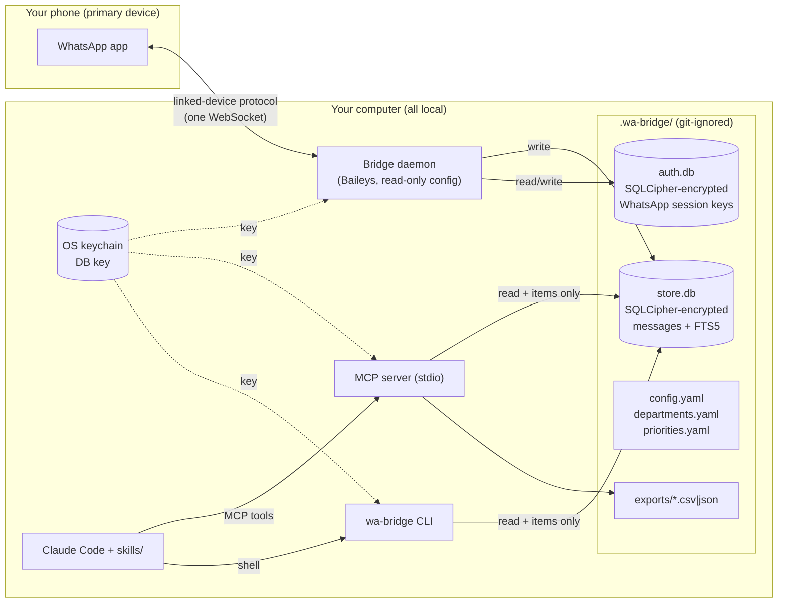
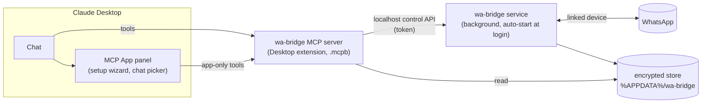

# wa-bridge — Plan (for approval)

Status: **draft, waiting for approval**. Research done 2026-10-21. No code written yet.

> ⚠️ wa-bridge links to WhatsApp as an unofficial linked device. This is against WhatsApp's Terms of Service and can get the number restricted or banned. Other people in your chats did not consent to their messages being stored or read by an AI. Each user links only their own number and accepts this risk.

---

## 1. Architecture



- **The daemon is the only process that talks to WhatsApp.** The MCP server and CLI only open `store.db`. They never import Baileys, and a lint rule enforces that.
- One daemon per account. A PID lock file (`.wa-bridge/daemon.lock`) stops a second instance from starting.
- `store.db` uses SQLite WAL mode, so the daemon writes while the MCP server and CLI read at the same time.
- **Data flow to Anthropic:** message text leaves the computer only when Claude calls an MCP tool or the CLI and reads the result. That is inherent to the design. The README will say so plainly.

## 2. Library choices (verified 2026-10-21)

| Need | Choice | Version checked | Why | Rejected |
|---|---|---|---|---|
| WhatsApp | `baileys` (WhiskeySockets) | 7.0.0-rc14 (2026-07-29), MIT, Node ≥20 | Speaks the WebSocket protocol directly, with no headless browser. Exposes `markOnlineOnConnect`, `syncFullHistory`, `shouldSyncHistoryMessage` and `browser`. Read receipts are sent only if you call `readMessages`. Active project. | `whatsapp-web.js` 1.34.7 (2026-04, Apache-2.0) runs a full Chromium through Puppeteer, which is heavier and more fragile. Fewer releases this year. |
| Encrypted DB | `better-sqlite3-multiple-ciphers` | 13.0.3, MIT, Node ≥22 | Prebuilt binaries for win/mac/linux on x64 and arm64. Whole-file encryption (SQLCipher v4 profile). FTS5 included. **Tested on this Windows machine:** FTS5 works, the file shows no plaintext, and opening without the key fails with `SQLITE_NOTADB`. | Field-level libsodium encryption leaks metadata (timestamps, chat ids, sizes) and does not work with FTS5, because the FTS index would hold plaintext. |
| Keychain | `@napi-rs/keyring` | 2.1.2 (updated 2026-10), MIT | Rust `keyring` crate behind N-API. Uses macOS Keychain, Windows Credential Manager and Secret Service/libsecret on Linux. **Tested here:** Windows round-trip works. | `keytar` is archived and no longer maintained. |
| MCP | `@modelcontextprotocol/server` (SDK v2) | 2.3.1, Apache-2.0 | Current stable v2 SDK, stdio transport. | `@modelcontextprotocol/sdk` 1.32.1 (v1) is still maintained. It is the fallback if v2 stdio has problems. |
| CLI / config / QR | `commander` 15, `yaml` 2, `qrcode` (terminal + PNG) | | Small and well known. | `qrcode-terminal` (no release since 2022) |
| Validation | `zod` | | The MCP SDK uses it for tool input schemas. | |
| Tests / lint | `vitest` 5, `typescript`, `eslint` (flat config) | | Required by the brief. | |

**Runtime:** Node **≥ 22.12** (better-sqlite3-mc and commander need it; you have Node 24.11).

**Security note:** Baileys versions before 6.7.22 and 7.0.0-rc12 have a critical message-spoofing CVE (CVE-2026-48063). We pin `>=7.0.0-rc14` exactly and record it in DECISIONS.md. Baileys v7 is still a release candidate, but the maintainers ship it as the npm `latest` tag. v6 is tagged `legacy`.

## 3. Read-only configuration of Baileys

The defaults I checked in rc14 source (`lib/Defaults/index.js`) are **not** safe for us, so we override them:

| Option | Baileys default | wa-bridge | Effect |
|---|---|---|---|
| `markOnlineOnConnect` | `true` | **`false`** | Sends presence `unavailable`, so you do not appear "online". |
| `syncFullHistory` | `true` | **`false`** | Does not ask the phone for full history. |
| `shouldSyncHistoryMessage` | everything except FULL | keep (no FULL) | Gets only the normal initial and recent sync a new linked device receives. |
| `fireInitQueries` | `true` | `true` | Normal startup queries a real WhatsApp Web client also makes. |
| `browser` | `Browsers.macOS('Chrome')` | OS-matching `Browsers.<os>('Desktop')`, set once at link time and never changed | Shows a stable, believable device name under *Linked devices*. |
| `getMessage` | none | reads from our store | Needed for retry decryption. Never sends anything. |
| media | not downloaded | `downloadMediaMessage` never imported | We store only `has_media` and the media type. |

**What still goes over the wire (unavoidable and normal):** every linked device sends **delivery acks/receipts** for messages it decrypts. With presence `unavailable`, Baileys sends them as type `inactive`. That is what an open-but-backgrounded WhatsApp Web tab does. This affects the grey "delivered" ticks, **not blue read ticks**, and your phone's unread counters stay unchanged. We cannot turn these off without breaking the protocol, and our own code never calls them.

**On "mimic WhatsApp Web so it doesn't get banned":** I will make the client behave like a quiet, normal WhatsApp Web session: one connection, stable device identity, offline presence, no full history pull, no media fetching, slow backoff on reconnect, and no polling queries (no profile-picture or presence lookups). **I will not add fingerprint spoofing or anti-detection tricks beyond Baileys' normal config.** That would not make it safe anyway. Bans are reported in 2026 even for light use (see §8). Please confirm this is acceptable.

## 4. Encryption and keys

- `wa-bridge init` creates a random 32-byte key and stores it in the OS keychain (service `wa-bridge`, account `<project-path-hash>`). The key never touches the project folder.
- `store.db` and `auth.db` are both SQLCipher-encrypted with that key (via a per-file key derived with HKDF from the master key).
- **The WhatsApp session is not stored as files.** Baileys' `useMultiFileAuthState` writes plaintext JSON, so we write our own `AuthenticationState` adapter backed by `auth.db`. No plaintext session data ever reaches disk.
- `qr.png` is written to `.wa-bridge/` during linking and **deleted** as soon as linking succeeds or times out. A QR code is a login secret for about 60 seconds.
- Linux without a Secret Service (headless): `init` stops with a clear error. There is no silent fallback to a key file.
- Logs (pino) record events and ids only, **never message text**. Log level comes from config.

## 5. Schema (store.db)

```sql
accounts(id TEXT PK,            -- own JID (phone number form)
         lid TEXT,              -- own LID; mentions may use either form
         push_name TEXT, link_status TEXT,      -- linked|connecting|disconnected|logged_out
         linked_at INT, last_connected_at INT, last_message_at INT)

chats(id TEXT PK, type TEXT CHECK(type IN('group','direct')), name TEXT,
      participant_count INT, muted INT, archived INT,
      included INT NOT NULL,     -- result of config filters, recomputed on config change
      last_message_at INT)

participants(chat_id TEXT, contact_id TEXT, display_name TEXT, is_admin INT,
             PRIMARY KEY(chat_id, contact_id))

messages(id TEXT, chat_id TEXT, sender_id TEXT, sender_name TEXT,
         ts INT,                 -- unix seconds
         text TEXT, quoted_id TEXT, quoted_sender_id TEXT,
         mentions TEXT,          -- JSON array of JIDs
         mention_reason TEXT,    -- at_mention | name | reply | NULL (not addressed to me)
         is_from_me INT, has_media INT, media_type TEXT,
         edited INT, deleted INT,
         PRIMARY KEY(chat_id, id))
messages_fts(text, content='messages')     -- FTS5, unicode61 remove_diacritics 2; kept in sync by triggers

unread_state(chat_id TEXT PK, reviewed_until INT)   -- ours only, never synced to WhatsApp

items(id INTEGER PK, chat_id TEXT, message_id TEXT, category TEXT,   -- critical|mention|request|fyi
      department TEXT, priority TEXT,                                -- critical|high|normal|low
      summary TEXT, requester TEXT, status TEXT DEFAULT 'open',      -- open|done|dismissed
      created_at INT, updated_at INT, UNIQUE(chat_id, message_id, category))

meta(key TEXT PK, value TEXT)   -- schema_version, last_sync_at, last_purge_at
```

- **Filtering happens at ingest.** Messages from excluded chats are **not stored at all** (only a chat row with `included=0`, so you can see the chat and turn it on). Direct chats are off by default.
- **Retention:** the daemon purges once an hour and at startup. It deletes messages older than `retention_days` (default 30) and their FTS rows, then runs `VACUUM` weekly. Items keep their own text summary, so they survive purges of the source message. The citation id may then point to a deleted message, and tools mark this with `source_purged: true`.

## 6. MCP tools — JSON shapes

All tools return compact JSON. Times use ISO-8601 in your configured timezone. Message refs always look like `"chat_id/message_id"`, so Claude can cite them.

```jsonc
// list_chats({ filter?: "groups"|"direct"|"all" = "groups", only_active_since?: ISO })
{ "chats": [{ "id": "1203…@g.us", "name": "ERP Support", "type": "group",
              "participants": 5, "last_message_at": "…", "unreviewed": 12, "included": true }] }

// get_new_messages({ since?: ISO | "last_review" = "last_review", chats?: string[], limit?: number = 300 })
{ "since": "…", "truncated": false,
  "chats": [{ "id": "…", "name": "ERP Support",
              "messages": [{ "ref": "chat/msgid", "ts": "…", "from": "Ali", "text": "…",
                             "reply_to": "chat/msgid"|null, "mentions_me": true,
                             "media": "image"|null, "edited": false, "deleted": false }] }] }

// get_messages({ chat, since?, until?, limit? = 100 })        -> { chat:{id,name}, messages:[…same shape…] }
// search_messages({ query, chats?, since?, limit? = 50 })     -> { hits:[{ chat_name, …message, snippet }] }
// get_mentions({ since? = "last_review" })                    -> { mentions:[{ chat_name, reason:"at_mention"|"name"|"reply", …message }] }
// get_chat_info({ chat })                                     -> { id, name, type, participants:[{id,name,admin}], included }
// get_status()
{ "account": "+92…", "link_status": "linked", "daemon_running": true,
  "last_connected_at": "…", "last_message_at": "…", "minutes_since_sync": 3,
  "counts": { "chats_included": 70, "messages": 18234, "open_items": 41 },
  "warnings": ["daemon not running"] }

// mark_reviewed({ chats?: string[], until: ISO })   -> { updated: 70 }
// save_items({ items:[{ ref, category, department?, priority, summary, requester? }] })
//                                                    -> { saved: 5, duplicates: 1, ids:[…] }
// list_items({ status?, department?, priority?, limit? })   -> { items:[{ id, ref, chat_name, age_hours, … }] }
// update_item({ id, status })                                -> { id, status }
// export_items({ format:"csv"|"json", path?, status? = "open" })   -> { path: ".wa-bridge/exports/items-2026-10-21.csv", count }
```

- `export_items.path` must resolve to a location **inside the project folder**. Anything else is rejected, so Claude cannot write elsewhere.
- Text is capped per message (default 2,000 chars) and per response (`limit` + `truncated` flag), so a busy group cannot flood Claude's context.
- Config files are read on every call, so edits take effect without restarting anything.

## 7. Read-only guard (written first, before any other code)

Three layers, all run in `npm test` and CI:

1. **Single import point.** Only `src/daemon/wa-client.ts` may import `baileys` (ESLint `no-restricted-imports` with a path override). The MCP server and CLI cannot reach the library at all.
2. **Static denylist test** (`test/guard/readonly.test.ts`). It scans every file in `src/` (AST via the TypeScript compiler API, not regex alone) and fails if it finds a call to or reference of any write API:
   `sendMessage, relayMessage, sendReceipt, sendReceipts, readMessages, sendPresenceUpdate, presenceSubscribe, chatModify, star, groupCreate, groupUpdate*, groupParticipantsUpdate, groupLeave, groupInvite*, groupAcceptInvite*, groupRevokeInvite*, groupToggleEphemeral, groupSettingUpdate, groupJoinApprovalMode, groupMemberAddMode, updateProfile*, removeProfilePicture, updateBlockStatus, update*Privacy, addOrEditContact, removeContact, addLabel*, removeLabel*, newsletter*, sendWAMBuffer, rejectCall, offerCall, appPatch, resyncAppState, downloadMediaMessage, fetchMessageHistory, requestPlaceholderResend`.
   Bracket access (`sock['send' + …]`) and spreading the socket object are also forbidden in that file.
3. **Runtime wrapper test.** `wa-client.ts` gives the rest of the daemon only an event-emitter facade, never the socket. A test builds the client against a mocked Baileys and checks: the socket config has `markOnlineOnConnect:false` and `syncFullHistory:false`, and no mocked write method is ever called during connect, ingest, reconnect and shutdown.

**One exception (approved 2026-10-21):** `wa-bridge unlink` calls `sock.logout()`. This removes the linked device from your phone's *Linked devices* list, as the brief asks. It is a session action, not a message action. It is allowed only in `wa-client.ts`'s `unlink()`, and only after you type a confirmation. The guard allowlists it by name.

## 8. Risks

| Risk | Note / mitigation |
|---|---|
| **Account ban** | Real and current. 2026 Baileys issues report bans and restrictions (#1869, #2309, #2805), mostly from sending, but some from just linking. Read-only use is lower risk, not zero. Mitigation: the `I accept` gate, quiet config, test on a secondary number first (see the test checklist). |
| Third-party consent | Others' messages are stored locally and read by Claude, which sends them to Anthropic. Mitigation: groups-only default, an allow/deny list, short retention, and the warning text says this. |
| Baileys protocol breakage | WhatsApp changes break unofficial clients. Mitigation: pin the version, `get_status` warns when the bridge is stale, and upgrades are a manual decision. |
| Baileys CVE history | Pin a version with the fix (≥ rc12). We ingest only `messages.upsert` with type `notify`/`append`. Protocol messages are never treated as content. |
| Native modules | `better-sqlite3-mc` and `@napi-rs/keyring` need prebuilt binaries. Both tested on Win x64. macOS and Linux are tested in Phase 3, plus a CI matrix if you want one. |
| Laptop asleep | Messages that arrive while offline are delivered when the daemon reconnects (WhatsApp keeps queued messages for linked devices for a limited time). WhatsApp also logs out linked devices if the **phone** is inactive for about 14 days. `get_status` warns when the bridge has not synced for a long time. |
| Reconnect storms | Backoff of 5 s → 10 → 20 … capped at 10 min, with jitter. It stops entirely on `loggedOut` / 401 / 403 and asks you to relink. It never loops on a bad QR. |

## 9. Open questions for you

1. **Anti-detection scope (§3):** OK with "quiet, normal WhatsApp Web behavior via official config options, no spoofing tricks"?
2. **`unlink` logout exception (§7):** OK?
3. **Project-folder scope:** the brief puts `.wa-bridge/` in the current project folder, so one project = one account = one daemon. Is that right, or do you want one global store (e.g. `~/.wa-bridge`) shared by every Claude project?
4. **Your names/nicknames:** I'll put placeholders in `config.yaml` for mention detection by name (e.g. "Zuhaib", "Zuhaib bhai", "ZA"). You fill them in at setup.
5. **Git:** OK to `git init` this folder now and commit after each step (on `main`, since it is a new repo)?
6. **Platforms:** You are on Windows 11. I can verify Windows end-to-end. macOS and Linux will have code and unit tests but no live check unless you or a friend can run the checklist there. OK?

## 10. Build order

**Phase 1:** scaffold (TS, ESLint, Vitest) → **guard test + encryption/keychain tests (first)** → config loader → store + schema + FTS + retention → Baileys auth adapter (encrypted) → daemon (`wa-client` facade, ingest, backoff, lock) → CLI `init, link, status, chats, new, search, purge, unlink` → unit tests with a mocked Baileys. Commit after each step, with lint, typecheck and tests passing.

**Phase 2:** MCP server with all tools → items + export → `departments.yaml` / `priorities.yaml` → 5 skills.

**Phase 3:** `daemon install|uninstall|start|stop` (Task Scheduler / launchd / systemd --user) → Claude install flow (`.mcp.json`, copy skills, run `wa-setup`) → README (warning first, install, uninstall) → manual test checklist (start with a secondary number).

---

## 11. Onboarding v2 — non-technical users on Claude Desktop (draft, 2026-10-22)

**Goal:** a friend installs one file in Claude Desktop, says "set up WhatsApp" to Claude, and completes everything through clicks in an in-chat panel. No terminal, ever.

**Target:** Claude Desktop (Windows first). claude.ai web is out of scope, because it cannot reach local tools without breaking "local only" (see ROADMAP). Claude Code is deferred.



1. **Install:** a `.mcpb` Desktop Extension (one click). It contains the MCP server, the service and the UI.
2. **"Set up WhatsApp":** Claude calls `open_setup`, and the **in-chat panel** (MCP App) shows:
   - **Risk warning** with an **"I accept" button the user clicks**. It is an app-only action Claude cannot perform.
   - The service is installed and started: keychain key, encrypted store, and auto-start at login, with a toggle.
   - **Live QR code.** The panel polls the service through an app-only tool. Then it shows "Linked ✓, syncing…".
   - **Chat picker:** search, Groups/DMs tabs, Select all / none, per-chat toggles, Save. This uses T11's `chooseChats`, `buildChatRows` and `writeSelection`. DM history from link time is kept only for chats the user picks.
   - **Done:** Claude offers scheduled briefs.
3. **Afterwards:** Claude manages everything by conversation. Tools for include/exclude, status, and relinking (the panel opens again when a QR is needed).

**Architecture changes**
- **Per-user data dir:** `%APPDATA%\wa-bridge`, `~/Library/Application Support/wa-bridge`, or `~/.local/share/wa-bridge`. `--project` is kept for development.
- **The service replaces "daemon start".** It can run while unlinked, performs linking on request, and exposes a localhost-only control API (random port + token file in the data dir, readable by the user only). It is still the only process that talks to WhatsApp.
- **The MCP server never talks to WhatsApp.** It reads the store and calls the service's control API (status, start link, QR, chat rows, apply selection).
- **Fallback when the panel cannot render:** the same HTML is served by the service at `http://127.0.0.1:<port>/setup?token=…`, and Claude gives the link.

**Open questions (research spike before building)**
1. **Runtime for the service** when Claude Desktop is closed: bundle `node.exe` in the `.mcpb`, a Node single executable app, or reuse Desktop's Node (whose path may change with updates)? Native modules (`better-sqlite3-multiple-ciphers`, `@napi-rs/keyring`) must ship prebuilt for win-x64.
2. **MCP Apps support** in our SDK (`@modelcontextprotocol/ext-apps` 2.x) and current Claude Desktop: app-only tool visibility, polling, and size limits for a 520-row picker.
3. **Do app-only tool results stay local in Desktop?** Assume they may be logged with the conversation: show the QR only in the panel, and keep chat names minimal.
4. **Auto-start on Windows:** a Task Scheduler entry at logon, per-user, no admin rights.
